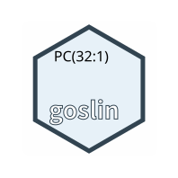

# Goslin



[](https://github.com/lifs-tools/goslin/actions/workflows/check-grammars.yml)
[](https://github.com/lifs-tools/goslin/tags)
[](https://doi.org/10.5281/zenodo.3824376)
[](https://github.com/lifs-tools/goslin/blob/master/LICENSE)

Goslin, the **G**rammar **o**f **S**uccinct **Li**pid **N**omenclature, is a set of [ANTLR 4](https://www.antlr.org/) grammars for lipid shorthand names. They cover the updated shorthand nomenclature of [Liebisch et al. (2020)](https://doi.org/10.1194/jlr.S120001025), the naming styles of LIPID MAPS, SwissLipids and HMDB, systematic fatty acid names and sum formulas. With them come shared tables of lipid classes and functional groups, and the test files that all Goslin implementations run against.

**This repository does not parse lipid names by itself.** To parse, validate or normalise lipid names, use the web application or one of the implementations below. They all read the grammars and tables from this repository.

## Parse lipid names

| Implementation | Language | Get it |
|---|---|---|
| [Goslin web application](https://apps.lifs-tools.org/goslin/) ([source](https://github.com/lifs-tools/goslin-webapp)) | Web, REST API | use it online |
| [pygoslin](https://github.com/lifs-tools/pygoslin) | Python | `pip install pygoslin` ([PyPI](https://pypi.org/project/pygoslin/)) |
| [jgoslin](https://github.com/lifs-tools/jgoslin) | Java, command line | `org.lifs-tools:jgoslin-parsers` and `jgoslin-cli` ([Maven Central](https://central.sonatype.com/namespace/org.lifs-tools)) |
| [rgoslin](https://github.com/lifs-tools/rgoslin) | R | `BiocManager::install("rgoslin")` ([Bioconductor](https://bioconductor.org/packages/rgoslin/)) |
| [cppgoslin](https://github.com/lifs-tools/cppgoslin) | C++ | build from source with `make` |
| [csgoslin](https://github.com/lifs-tools/csgoslin) | C# | build from source with `dotnet` |

All implementations normalise a parsed name to the shorthand nomenclature of Liebisch et al. (2020), at the most specific structural level the name supports.

## Grammars and data

| Grammar | Reads | Railroad diagram |
|---|---|---|
| [`Shorthand2020.g4`](https://github.com/lifs-tools/goslin/blob/master/Shorthand2020.g4) | the updated lipid shorthand nomenclature ([Liebisch et al. 2020](https://doi.org/10.1194/jlr.S120001025)), on all structural levels | [view](https://lifs-tools.github.io/goslin/docs/grammars/Shorthand2020/Shorthand2020.html) |
| [`Goslin.g4`](https://github.com/lifs-tools/goslin/blob/master/Goslin.g4) | Goslin's dialect of the earlier shorthand notation, with adducts | [view](https://lifs-tools.github.io/goslin/docs/grammars/Goslin/Goslin.html) |
| [`GoslinFragments.g4`](https://github.com/lifs-tools/goslin/blob/master/GoslinFragments.g4) | Goslin names followed by ` - ` and a fragment name | [view](https://lifs-tools.github.io/goslin/docs/grammars/GoslinFragments/GoslinFragments.html) |
| [`LipidMaps.g4`](https://github.com/lifs-tools/goslin/blob/master/LipidMaps.g4) | LIPID MAPS abbreviations, for example `PC(16:0/18:1(9Z))` | [view](https://lifs-tools.github.io/goslin/docs/grammars/LipidMaps/LipidMaps.html) |
| [`SwissLipids.g4`](https://github.com/lifs-tools/goslin/blob/master/SwissLipids.g4) | SwissLipids abbreviations | [view](https://lifs-tools.github.io/goslin/docs/grammars/SwissLipids/SwissLipids.html) |
| [`HMDB.g4`](https://github.com/lifs-tools/goslin/blob/master/HMDB.g4) | HMDB lipid names | [view](https://lifs-tools.github.io/goslin/docs/grammars/HMDB/HMDB.html) |
| [`FattyAcids.g4`](https://github.com/lifs-tools/goslin/blob/master/FattyAcids.g4) | systematic fatty acid names, for example `hexadecanoic acid` (`FA 16:0`) | [view](https://lifs-tools.github.io/goslin/docs/grammars/FattyAcids/FattyAcids.html) |
| [`SumFormula.g4`](https://github.com/lifs-tools/goslin/blob/master/SumFormula.g4) | molecular sum formulas, for example `C42H82NO8P` | [view](https://lifs-tools.github.io/goslin/docs/grammars/SumFormula/SumFormula.html) |
| [`Systematic.g4`](https://github.com/lifs-tools/goslin/blob/master/Systematic.g4) | systematic lipid names; experimental, not yet ANTLR 4 compatible ([#42](https://github.com/lifs-tools/goslin/issues/42)) | – |

| Data file | Contents |
|---|---|
| [`lipid-list.csv`](https://github.com/lifs-tools/goslin/blob/master/lipid-list.csv) | the lipid classes: name, category, description, number of fatty acyl chains, head group sum formula and synonyms |
| [`functional-groups.csv`](https://github.com/lifs-tools/goslin/blob/master/functional-groups.csv) | the functional groups: name, elements, double bonds and synonyms |
| [`trivial_mediators.csv`](https://github.com/lifs-tools/goslin/blob/master/trivial_mediators.csv) | trivial names of lipid mediators with their double bond positions, for example `10-HDoHE` |

## How the grammars reach the implementations

The implementations do not use code generated by ANTLR. Each has its own generic parser that reads the `.g4` files and the data tables from a copy of this repository, kept as a git subtree:

| Implementation | Copy of this repository |
|---|---|
| pygoslin | `pygoslin/data/goslin` |
| jgoslin | `parsers/src/main/goslin` |
| cppgoslin | `data/goslin`, compiled into `KnownGrammars.h` |
| csgoslin | `data/goslin` |
| rgoslin | `src/cppgoslin/data/goslin`, through cppgoslin |

A change here takes effect in an implementation only after that implementation pulls the subtree and makes a release, and the implementations may lag behind this repository. Releases are made by hand for each implementation. Keeping them in sync is tracked in [#57](https://github.com/lifs-tools/goslin/issues/57).

## Documentation

- [Implementation and user guide](https://lifs-tools.github.io/goslin/docs/README.html): the structural levels, the object model and an introduction to each implementation.
- The README of each implementation (see [Parse lipid names](#parse-lipid-names)) for installation and API details.
- [Goslin on the LIFS Tools website](https://lifs-tools.org/tools/goslin).

## Contributing

Contributions are welcome. Please follow the [LIFS Tools contribution guidelines](https://github.com/lifs-tools/.github/blob/main/CONTRIBUTING.md) and the [code of conduct](https://github.com/lifs-tools/goslin/blob/master/CODE_OF_CONDUCT.md).

To change a grammar or a data table:

1. Open an issue with the names that are not parsed, or are parsed wrongly, and the result you expect. Name the implementation and version you used.
2. Change the grammar. A new lipid class also goes into `lipid-list.csv`, a new functional group into `functional-groups.csv`.
3. Add test rows to the matching file in [`testfiles/`](https://github.com/lifs-tools/goslin/tree/master/testfiles).
4. Check the grammars with `./gradlew build` (see below).
5. Run at least one implementation's test suite against your branch, for example by pulling it into the pygoslin subtree.
6. Regenerate the railroad diagram of each grammar you changed (see below).
7. Open a pull request.

### Checking the grammars

The grammars are checked with [ANTLR](https://www.antlr.org/) 4.13.2 through the Gradle wrapper in this repository. You need a JDK 17 or newer; Gradle itself is downloaded by the wrapper.

```shell
./gradlew build
```

On Windows, use `gradlew.bat build`. Each grammar listed in `build.gradle` gets its own task, for example `./gradlew antlr-Shorthand2020.g4` checks only that grammar. The build fails if a grammar has an error, or if a listed grammar file is missing. Add `--continue` to see the errors of all grammars, not only of the first one. When you add a new grammar, also add it to the list in `build.gradle`. `Systematic.g4` is not in the list yet, as it does not compile with ANTLR 4 ([#42](https://github.com/lifs-tools/goslin/issues/42)).

This only checks that ANTLR accepts the grammars. The implementations read the grammars with their own parsers, so a grammar change should also be tested with at least one implementation's test suite.

The same check runs on GitHub Actions for every push to `master` and every pull request. On a push to `master`, the workflow also publishes the documentation to GitHub Pages.

### Test files

[`testfiles/README.md`](https://github.com/lifs-tools/goslin/blob/master/testfiles/README.md) lists the test files, their format and the implementations that use them.

### Railroad diagrams

The railroad diagrams in [`docs/grammars/`](https://github.com/lifs-tools/goslin/tree/master/docs/grammars) are HTML exports from the [ANTLR extension for Visual Studio Code](https://marketplace.visualstudio.com/items?itemName=mike-lischke.vscode-antlr4): open the grammar, run "ANTLR: Show Railroad Diagram for All Rules", save the diagram as HTML from its view and replace `docs/grammars/<Grammar>/<Grammar>.html`. The current diagrams date from November 2024; grammars changed since then are newer than their diagrams.

## Versions and releases

Versions are git tags of the form `vX.Y.Z`; see the [tags](https://github.com/lifs-tools/goslin/tags). Up to v2.2.0, each version also has a [GitHub release](https://github.com/lifs-tools/goslin/releases), archived on [Zenodo](https://doi.org/10.5281/zenodo.3824376). The implementations have their own version numbers.

## Getting help

- A lipid name is not parsed, or parsed wrongly: [open an issue here](https://github.com/lifs-tools/goslin/issues/new/choose) with the name and the result you expect.
- A problem with the API, installation or performance of an implementation: open an issue in that implementation's repository.
- Questions and ideas: [GitHub Discussions](https://github.com/lifs-tools/goslin/discussions).

## Citing Goslin

If you use Goslin or one of its implementations in your work, please cite:

- D. Kopczynski, N. Hoffmann, B. Peng, R. Ahrends. Goslin: A Grammar of Succinct Lipid Nomenclature. *Analytical Chemistry* 92(16), 10957–10960 (2020). [doi:10.1021/acs.analchem.0c01690](https://doi.org/10.1021/acs.analchem.0c01690)

If you use the updated shorthand nomenclature or other features of Goslin 2.0 and later, please also cite:

- D. Kopczynski, N. Hoffmann, B. Peng, G. Liebisch, F. Spener, R. Ahrends. Goslin 2.0 Implements the Recent Lipid Shorthand Nomenclature for MS-Derived Lipid Structures. *Analytical Chemistry* 94(16), 6097–6101 (2022). [doi:10.1021/acs.analchem.1c05430](https://doi.org/10.1021/acs.analchem.1c05430)

A preprint of the first paper is available on [bioRxiv](https://doi.org/10.1101/2020.04.17.046656). GitHub's "Cite this repository" button uses [`CITATION.cff`](https://github.com/lifs-tools/goslin/blob/master/CITATION.cff).

## License

The Goslin grammars and data files are licensed under the terms of the MIT license; see [LICENSE](https://github.com/lifs-tools/goslin/blob/master/LICENSE).
